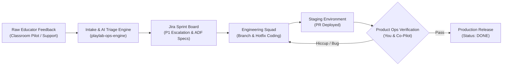

# Playlab Product Operations & Jira Intelligence Engine
> *"The Architect on the way in, and the Inspector on the way out."*

[](https://nodejs.org/)
[](https://developer.atlassian.com/cloud/jira/platform/rest/v3/intro/)
[](https://modelcontextprotocol.io/)
[](https://opensource.org/licenses/MIT)

**Designed by:** John DeVito  
**Target Organization:** [Playlab](https://www.playlab.ai) (`playlab-education`)  
**Core Purpose:** An autonomous operational harness and triage engine designed to bridge unstructured educator feedback, agile Jira sprint execution, and executive product health reporting with zero friction.

---

## 1. Executive Summary & Operational Philosophy

In fast-scaling educational AI ecosystems like Playlab (serving 100,000+ educators), the primary operational bottleneck is rarely writing code—it is **information asymmetry and context fragmentation** between classroom users, support queues, and engineering squads.

This engine enforces a modern Product Operations standard:

* **The Architect on the Way In:** Ingests raw, unstructured teacher bug reports and feature requests, extracts technical variables, deduces reproduction steps, runs root-cause analysis, and stages structured, actionable user stories in Jira before an engineer ever reads the ticket.
* **The Inspector on the Way Out:** Acts as the quality gatekeeper on Staging environments. Verifies that engineering hotfixes actually resolve educator classroom workflows before approving production release.



---

## 2. Core Capabilities

### 1. Autonomous Product Intake & Technical Triage
* **Zero Guesswork for Developers:** Parses vague teacher feedback (*"the app froze on step 3"*) into precision technical bug reports.
* **Automated Atlassian Document Format (ADF):** Generates structured Jira tickets with severity scoring (P0–P3), blast-radius calculation, reproduction flows, and architectural recommendations (e.g., frontend chunking vs. async queue migration).
* **Live Jira Commenting:** Posts immediate technical triage notes directly to the Jira issue via REST API v3.

### 2. Pre-Standup Command Center (5:00 AM Cloud Runner)
* **Automated Overnight Sweeps:** A scheduled runner (via GitHub Actions or local daemon) executes at **5:00 AM Central Time**, sweeping active sprint boards, blocker flags, and ticket deltas.
* **6:30 AM War Room Briefing:** Pre-compiles a clean, dark-mode **Executive Briefing Dashboard** (`templates/morning_briefing.html`) stored locally on disk.
* **100% Offline Resilience:** You review the briefing with zero API latency and zero Wi-Fi dependencies before daily team standups.

### 3. Model Context Protocol (MCP) Native
* **Two-Way AI Integration:** Configured to work seamlessly with **Claude Desktop / Cowork** and **Antigravity / Gemini** using `@ahmetbarut/jira-mcp-server`.
* Allows natural-language ticket queries, JQL execution, and automated status transitions directly from the AI chat interface.

---

## 3. Architecture & Repository Structure

```
playlab-product-ops-engine/
├── .github/
│   └── workflows/
│       └── daily-briefing.yml   # Scheduled 5:00 AM cloud cron runner (GitHub Actions)
├── src/
│   ├── jira-client.js           # Lightweight, zero-dependency Jira Cloud v3 wrapper
│   ├── triage-runner.js         # Simulates educator intake & auto-posts technical diagnosis
│   └── briefing-runner.js       # Sweeps board & compiles offline morning briefing
├── templates/
│   └── morning_briefing.html    # Responsive dark-mode executive briefing dashboard
├── .env.example                 # Configuration template for Atlassian credentials
├── .gitignore                   # Rigorous protection for all secrets & API tokens
├── package.json                 # Project manifest & execution scripts
└── README.md                    # Operational blueprint & system documentation
```

---

## 4. Daily Cadence: A Day in the Life

| Time Window | Phase | Operational Activity |
| :--- | :--- | :--- |
| **5:00 AM CT** | **Autonomous Sweeper** | GitHub Actions runs `briefing-runner.js`, queries Jira REST API, evaluates blocker states, and exports cached briefing artifact. |
| **6:30 – 7:00 AM CT** | **Strategy War Room** | Product Ops Manager opens local briefing; reviews sprint velocity, evaluates P1 blockers, and drafts standup talking points before team logs on. |
| **7:00 – 11:30 AM CT** | **Intake & Triage** | Ingest incoming feedback from pilot school coordinators. Run `triage-runner.js` to format specs and stage tickets in `To Do`. |
| **1:00 – 3:30 PM CT** | **Verification Gate** | Verify staging deployments for completed engineering PRs. Test student rosters, inspect logs, and authorize `Done` status. |
| **4:30 – 5:00 PM CT** | **Executive Rollup** | Generate automated end-of-day health summary for Head of Product & Executive Leadership. |

---

## 5. Quickstart & Installation

### Prerequisites
* Node.js v18+ (tested on Node v20/v25)
* Atlassian Jira Cloud instance & API Token

### Setup
1. **Clone the repository:**
   ```bash
   git clone https://github.com/your-username/playlab-product-ops-engine.git
   cd playlab-product-ops-engine
   ```

2. **Configure Environment Variables:**
   ```bash
   cp .env.example .env
   ```
   Add your Atlassian credentials to `.env`:
   ```env
   JIRA_BASE_URL=https://your-domain.atlassian.net
   JIRA_EMAIL=your-email@example.com
   JIRA_API_TOKEN=your_atlassian_api_token
   JIRA_PROJECT_KEY=OPS
   ```

3. **Run the Triage Engine Simulation:**
   ```bash
   npm run triage
   ```

4. **Generate the Morning Executive Briefing:**
   ```bash
   npm run briefing
   ```
   Open `templates/morning_briefing.html` in any browser to inspect the offline command center.

---

## 6. Security & Credential Hygiene

* **Zero Token Leakage:** `.env` and all credential stores are strictly excluded via `.gitignore`.
* **Least Privilege:** Designed to operate using read/write scopes limited exclusively to targeted Jira projects.
* **CI/CD Hardening:** GitHub Actions workflow consumes credentials exclusively via encrypted **GitHub Repository Secrets** (`${{ secrets.JIRA_API_TOKEN }}`).

---

## About the Author

**John DeVito** is a 20+ year founder-operator and strategic executive specializing in 0-to-1 company building, physical and digital operational architecture, regulatory navigation, and AI-augmented process automation.

* **LinkedIn:** [linkedin.com/in/john-devito-okc](https://linkedin.com/in/john-devito-okc)  
* **Email:** [johndevitoinfo@gmail.com](mailto:johndevitoinfo@gmail.com)
