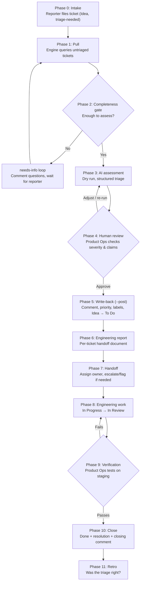

# Product Ops Triage & Engineering Handoff SOP

**Status:** Draft v0.1 (2026-10-20), sandbox only. Not yet approved for production tickets.
**Owner:** John DeVito, Product Operations
**Applies to:** Jira project `KAN` and the `playlab-product-ops-engine` repository

---

## 1. Purpose

Every ticket that reaches engineering should arrive with the work of understanding it already done: what broke, who is affected, how bad it is, what evidence exists, where to start looking, and what "fixed" means. Engineers should spend their first hour fixing, not deciphering.

This SOP defines the end-to-end flow:

**Intake → Pull → Completeness gate → AI assessment → Human review → Jira write-back → Engineering report → Handoff → Engineering work → Verification → Close → Retro**

It also defines the field, label, and status conventions every phase relies on, and the loops for when something is missing or fails verification.

### 1.1 What this process can and cannot tell engineers

| The report can state as **Confirmed** | The report can only state as **Suspected** |
|---|---|
| Anything quoted directly from the ticket or attached evidence: error messages, HTTP status codes, timestamps, request IDs, stack-trace file and line numbers, log lines | Which component, config, or code path is responsible when no evidence points to it |
| Reproduction steps the reporter provided | Root cause |
| Who reported it, when, and the stated impact | Fix effort and risk |

The engine (Claude) sees **only the Jira ticket**: summary, description, fields, and any text evidence pasted into it. It has no access to the codebase, logs, or infrastructure. **Line-level precision ("timeout at `gateway.yaml` line 42", "`NullPointerException` at `QuizService.java:118`") is only possible when that evidence is in the ticket.** That is why Phase 0 requires evidence collection, and why every line item in the report carries a confidence label.

**Engineering stack: not yet known to the engine.** The engine has no knowledge of Playlab's actual languages, frameworks, databases, or service names. Any mention of a specific technology in a triage today is reasoning from the ticket text, not knowledge of the codebase. Until the stack profile (Section 11, question 11) is filled in and given to the engine, reports must not name specific files, classes, tables, or services unless they appear in the ticket's evidence.

---

## 2. Roles

| Role | Who | Responsibilities |
|---|---|---|
| **Reporter** | Educator, support agent, or internal user | Describes the problem; supplies evidence when asked |
| **Product Ops (triage owner)** | John DeVito | Runs the engine, reviews every AI assessment, owns severity and escalation, publishes reports, verifies fixes on staging, closes tickets |
| **Triage engine** | `playlab-product-ops-engine` + Claude (`claude-opus-5-5`) | Pulls tickets, produces structured assessments, writes approved results back to Jira, generates reports |
| **Engineering owner** | Assigned engineer | Diagnoses and fixes using the report; updates status; links PRs |
| **Engineering lead** | TBD | Accepts handoffs, assigns owners, arbitrates priority conflicts |

**Rule:** the engine recommends; a human decides. Nothing the engine writes is final until Product Ops has reviewed it (Phase 4).

---

## 3. Process overview



---

## 4. Phases in detail

Each phase lists its **trigger, owner, inputs, steps, outputs, and exit criteria**. Commands marked **(planned)** do not exist yet; see Section 8.

### Phase 0: Intake

- **Trigger:** A problem or request is reported (support queue, pilot feedback, internal).
- **Owner:** Reporter, with Product Ops enforcing the standard.
- **Steps:**
  1. Create a Jira ticket in `KAN` with status **Idea** and label **`triage-needed`**.
  2. Fill the intake template below. Paste evidence **as text** in the description where possible. The engine cannot read screenshots or attachments today.
- **Intake template (paste into description):**

  ```
  SUMMARY: One sentence: what is broken or requested.
  WHO IS AFFECTED: Users/roles, count, schools/districts, internal or external.
  WHERE: App/feature name, page/step, environment (production/staging), browser/device.
  WHEN: Date/time first seen (with timezone); ongoing or intermittent?
  STEPS TO REPRODUCE: Numbered steps.
  EXPECTED: What should happen.
  ACTUAL: What happens instead, including the exact error text.
  EVIDENCE (paste as text):
    - Error messages / HTTP status codes
    - Request IDs / trace IDs
    - Log excerpts with timestamps
    - Stack traces (include file names and line numbers)
    - Config values involved (e.g., timeout settings)
  WORKAROUND: Is there one? What is it?
  ```

- **Evidence by layer.** Ask for whatever applies. Each item lets the report cite an exact location instead of guessing:

  | Layer | Evidence to paste | Example of what the report can then cite |
  |---|---|---|
  | Backend (Java/JVM) | Full stack trace including `Caused by:` chains; exception class and message; thread name | `java.net.SocketTimeoutException` at `QuizGenerationService.generate(QuizGenerationService.java:118)` |
  | Database (SQL) | Failing or slow query text; DB error code (e.g., `ORA-01013`, PostgreSQL `57014 query_canceled`, MySQL `1205 lock wait timeout`); slow-query log line with duration and rows examined; `EXPLAIN` output | Query on `student_profiles` took 47.2 s, full table scan, exceeded the 45 s statement timeout |
  | API / gateway / infra | HTTP status, response headers, gateway or load-balancer log line, timeout config values | `504 Gateway Timeout` from the gateway after 45000 ms; `proxy_read_timeout 45s` |
  | Frontend (JS/TS) | Browser console errors with source file:line; network-tab entry (status, timing); app version | `Uncaught TypeError` at `quizBuilder.js:212`; request `POST /generate` stalled 45.0 s |
  | Mobile / desktop app | Crash log, OS and app version | Crash in `RosterUploadView` on iOS 18.1, app 3.4.2 |
  | Third-party / AI provider | Provider error codes, rate-limit responses, latency | `429 rate_limit_error` from the LLM provider at 08:14:03Z |

  Redact student names and any personal data before pasting (see Section 10).

- **Output:** Ticket in **Idea** with `triage-needed`.
- **Exit criteria:** Ticket exists and is labeled. (Completeness is judged in Phase 2, not here.)

### Phase 1: Pull

- **Trigger:** Scheduled daily sweep (target: 5:00 AM CT), or on demand.
- **Owner:** Triage engine, started by Product Ops.
- **Steps:**
  1. Query untriaged tickets: `project = KAN AND (status = Idea OR labels = triage-needed) ORDER BY created ASC`.
  2. For each ticket, read summary, status, priority, labels, and description.
- **Commands:**
  - Single ticket (exists): `npm run triage -- --issue KAN-5`
  - All untriaged tickets (planned): `npm run triage -- --all-untriaged`
- **Output:** List of tickets to assess.
- **Exit criteria:** Every untriaged ticket is queued for Phase 2.

### Phase 2: Completeness gate

- **Trigger:** A pulled ticket.
- **Owner:** Triage engine (automatic), Product Ops (override).
- **Rule:** A ticket with **no description** fails the gate. *(Today the engine checks only for an empty description. Planned: also fail tickets missing WHO, WHERE, or ACTUAL from the intake template.)*
- **Steps when the gate fails (the needs-info loop):**
  1. The engine still runs an assessment so the comment lists exactly what is missing.
  2. With `--post`: label **`needs-info`**, remove `triage-needed`, **leave priority and status unchanged**.
  3. Product Ops sends the "Missing information" list to the reporter.
  4. When the reporter updates the ticket, swap `needs-info` back to **`triage-needed`**. The ticket re-enters Phase 1.
- **Exit criteria:** Ticket passes the gate, or is parked in `needs-info` with questions sent.
- **Timebox:** If there is no reporter response in **5 business days**, Product Ops closes the ticket as *Won't Do* with a comment. *(Proposed; confirm in Q&A.)*

### Phase 3: AI assessment (dry run)

- **Trigger:** Ticket passes Phase 2.
- **Owner:** Triage engine.
- **Command (exists):** `npm run triage -- --issue KAN-5`. A dry run is the default and writes nothing to Jira.
- **What Claude produces** (schema-validated):

  | Section | Content |
  |---|---|
  | Assessment | Severity P0–P3 with rationale and escalation triggers; category |
  | Blast radius | Who and how many are affected, which organizations, features (and other features likely sharing the code path), environments, trigger condition, data impact, workaround, time sensitivity, and trend. Each dimension is marked Confirmed / Suspected / Unknown. *(Today the engine returns blast radius as one paragraph; planned: these structured dimensions.)* |
  | Root cause hypothesis | Most likely mechanism, explicitly unverified, plus alternatives to rule out |
  | Where to look | Components, configs, and layers to check, each phrased as a hypothesis |
  | Reproduction steps | From the ticket, with gaps or contradictions noted |
  | Diagnosis plan | Ordered steps: action → what the result tells you |
  | Fix options | Immediate mitigation, short-term fix, long-term fix, each with steps and tradeoffs |
  | Next actions | Concrete next steps |
  | Missing information | Questions for the reporter |

- **Cost:** About 3–6K tokens per ticket (roughly $0.03–$0.10 at current pricing; measured on KAN-1 through KAN-5).
- **Output:** Assessment printed to the terminal for review.
- **Exit criteria:** Assessment produced without errors.

### Phase 4: Human review

- **Trigger:** Phase 3 output.
- **Owner:** Product Ops. **This phase is mandatory.**
- **Review checklist:**
  - [ ] **Severity:** Does P0–P3 match real-world impact you know about (pilot visibility, deadlines, customers) that the ticket doesn't mention?
  - [ ] **No invented facts:** Every "Confirmed" statement traces to the ticket text.
  - [ ] **Hypotheses are labeled as hypotheses:** No claim about a specific file, line, or config unless the evidence is in the ticket.
  - [ ] **Contradictions caught:** Inconsistencies in the ticket are flagged (e.g., "error modal" vs "spinner").
  - [ ] **Missing info is reasonable:** Questions are answerable by the reporter.
  - [ ] **Escalation:** Does any escalation trigger apply now? (See Section 6.)
- **Outcomes:**
  - **Approve:** go to Phase 5.
  - **Re-run:** add the missing context to the ticket description, then repeat Phase 3.
  - **Override:** proceed with Phase 5, then correct severity and priority by hand in Jira and note why in a comment.
- **Exit criteria:** Product Ops approves the assessment.

### Phase 5: Jira write-back

- **Trigger:** Approval in Phase 4.
- **Owner:** Triage engine (executes), Product Ops (runs the command).
- **Command (exists):** `npm run triage -- --issue KAN-5 --post`
- **What changes in Jira:**

  | Field | Ticket has a description | Ticket fails the completeness gate |
  |---|---|---|
  | Comment | Full triage, formatted (headings, lists) | Full triage (mostly missing-info questions) |
  | Priority | From severity (Section 5.1) | Unchanged |
  | Labels | `+triaged`, `+severity-pX`, `−triage-needed` | `+needs-info`, `−triage-needed` |
  | Status | **Idea → To Do** (only from Idea; never moves backward) | Unchanged |
  | Assignee | Unchanged (Phase 7) | Unchanged |

- **Note:** The engine re-runs Claude on `--post`, so the posted text can differ slightly in wording from the dry run you reviewed. *(Planned fix: save the dry-run result and post exactly that.)*
- **Exit criteria:** Comment posted and fields updated; verify in Jira.

### Phase 6: Engineering report

- **Trigger:** Ticket triaged (Phase 5 complete).
- **Owner:** Triage engine (generates, planned), Product Ops (reviews and sends).
- **Command (planned):** `npm run report -- --issue KAN-5`, or `npm run report -- --triaged-since 2026-10-20` for a batch.
- **Output:** A Markdown/HTML report per ticket (spec in Section 7), saved to `reports/` and optionally posted as a Jira comment or attachment.
- **Exit criteria:** Report reviewed by Product Ops and attached to or linked from the ticket.

### Phase 7: Handoff

- **Trigger:** Report ready.
- **Owner:** Product Ops → Engineering lead.
- **Steps:**
  1. Assign the engineering owner (or the lead, who assigns).
  2. Apply escalation and flags per Section 6.
  3. Share the report link in the team channel or standup.
  4. Comment on the ticket: "Handed off to @owner; report: <link>."
- **Exit criteria:** Owner assigned and has acknowledged.

### Phase 8: Engineering work

- **Trigger:** Owner starts work.
- **Owner:** Engineering owner.
- **Steps:**
  1. Move **To Do → In Progress**.
  2. Follow the report's diagnosis plan; record findings as ticket comments, especially which hypotheses were confirmed or ruled out.
  3. If blocked: set **Flagged → Impediment** and comment with the blocker.
  4. Open a PR referencing the ticket key (e.g., `KAN-5: chunk roster generation`).
  5. Move **In Progress → In Review**; clear the flag.
- **Exit criteria:** Fix in review with the PR linked.

### Phase 9: Verification ("Inspector on the way out")

- **Trigger:** Ticket in **In Review** with a fix deployed to staging.
- **Owner:** Product Ops.
- **Steps:**
  1. Re-run the original reproduction steps on staging.
  2. Check the acceptance criteria from the report.
  3. Test edge cases from the report (e.g., threshold sizes, concurrent users).
- **Outcomes:**
  - **Pass:** go to Phase 10.
  - **Fail:** move back to **In Progress** with a comment describing what failed (the reopen loop).
- **Exit criteria:** All acceptance criteria verified.

### Phase 10: Close

- **Trigger:** Verification passes and the fix is released.
- **Owner:** Product Ops.
- **Steps:**
  1. Move **In Review → Done**. Jira sets resolution to *Done*.
  2. Add the `resolved` label.
  3. Closing comment: what was fixed, the PR link, the release date, and any follow-up tickets (e.g., the long-term fix).
  4. Notify the reporter or stakeholders.
- **Exit criteria:** Ticket Done, resolution set, reporter notified.

### Phase 11: Retro (weekly)

- **Owner:** Product Ops.
- **Review for tickets closed this week:**
  - Was the triage severity right? (Compare with the final priority.)
  - Which hypothesis turned out to be the root cause, if any?
  - How long did each phase take? (Section 9 metrics.)
  - Did the report save engineering time? Ask the owner.
- **Output:** Adjustments to this SOP, the intake template, or the engine prompt.

---

## 5. Conventions

### 5.1 Severity → priority

| Severity | Meaning | Jira priority |
|---|---|---|
| **P0** | Outage, data loss, or security issue; no workaround | Highest |
| **P1** | Core feature broken for many users; no reasonable workaround; or an active pilot/customer blocked | High |
| **P2** | Feature degraded; a workaround exists | Medium |
| **P3** | Minor issue, cosmetic, or not enough information to assess | Low |

### 5.2 Labels

| Label | Set by | Meaning |
|---|---|---|
| `triage-needed` | Reporter / Product Ops | Waiting for triage |
| `needs-info` | Engine (`--post`) | Failed the completeness gate; questions sent to reporter |
| `triaged` | Engine (`--post`) | Assessed and approved |
| `severity-p0` … `severity-p3` | Engine (`--post`) | Triage severity (priority may later be changed by humans; this records the original assessment) |
| `escalated` | Product Ops | Priority raised above the triage severity (Section 6) |
| `resolved` | Product Ops | Fixed, verified, and released |

### 5.3 Statuses and who moves them

| Status | Entered when | Moved by |
|---|---|---|
| Idea | Ticket created | Reporter |
| To Do | Triage approved and posted | Engine (`--post`) |
| In Progress | Engineer starts work | Engineering owner |
| In Review | Fix in PR / on staging | Engineering owner |
| Done | Verified and released | Product Ops |

### 5.4 Flags and assignee

- **Flagged (Impediment):** set when work is blocked (external dependency, missing info mid-work, an active pilot blocked). Cleared when unblocked. Always paired with a comment explaining the blocker.
- **Assignee:** empty until Phase 7. Product Ops may self-assign during Phases 2–6 if they are actively chasing information.

---

## 6. Escalation rules

Escalate (raise priority, add `escalated`, set the flag if blocking, and comment why) when **any** of these hold:

1. The triage lists escalation triggers and one is now true (e.g., the failure is spreading, data loss is found).
2. An active pilot, district, or paying customer is blocked during instructional time.
3. There is no workaround and the issue affects a core workflow.
4. The same issue is reported by 3+ independent reporters within 48 hours.
5. A P1 has had no owner for 1 business day, or a P0 for 1 hour.

De-escalate (lower priority, comment why) when a workaround is confirmed and communicated, or when the impact turns out to be smaller than assessed.

---

## 7. Engineering report specification

One report per ticket. Every line item carries a **confidence level**:

- **Confirmed:** quoted from the ticket or attached evidence (cite the source)
- **Suspected:** a hypothesis from the assessment (must be verified)
- **Unknown:** not determinable from available information

### 7.1 Report template

```markdown
# Engineering Report: KAN-5
**[Playlab Ops] Teacher AI Quiz Generator: Timeout on Step 3 for Classrooms > 30 Students**

| Field | Value |
|---|---|
| Ticket | https://johndevitoinfo.atlassian.net/browse/KAN-5 |
| Severity / Priority | P2 / Medium (escalated to High: active pilot) |
| Category | Bug |
| Status / Owner | To Do / unassigned |
| Reported / Triaged | 2026-10-20 / 2026-10-20 by claude-opus-5-5, reviewed by J. DeVito |

## 1. TL;DR (3 lines max)
Quiz generation fails for rosters >30 students: requests hit a ~45s timeout.
Workaround: split rosters ≤30. Start with: find which layer enforces 45s (Section 4, item 1).

## 2. Blast radius
| Dimension | Assessment | Confidence |
|---|---|---|
| Users affected | 8th-grade science teachers; count unknown | Confirmed (who) / Unknown (how many) |
| Organizations | 4 CPS pilot schools | Confirmed: ticket |
| Features | "Custom Science Quiz Builder", Generate Tiered Prompts | Confirmed: ticket |
| Other features on the same code path | Any per-student batch generation app | Suspected |
| Environments | Production (pilot) | Suspected |
| Trigger condition | Rosters >30 students | Confirmed (exact threshold Unknown) |
| Data impact | No data loss reported; possible orphaned/duplicate jobs | Unknown |
| Workaround | Split rosters ≤30 (manual) | Confirmed: ticket |
| Time sensitivity | Blocks class-time use during an active pilot | Confirmed: ticket |
| Trend | One report; spread unknown | Unknown |

## 3. Evidence line items
| # | Evidence | Source | Location | Timestamp | Confidence |
|---|---|---|---|---|---|
| E1 | Request fails after ~45 s | Ticket description | Generation request, "Generate Tiered Prompts" | Morning testing block (exact time unknown) | Confirmed |
| E2 | UI shows generic "Network Error" modal | Ticket description | Quiz Builder frontend | — | Confirmed |
| E3 | UI spins indefinitely | Ticket repro step 4 | Quiz Builder frontend | — | Confirmed (contradicts E2) |
| E4 | Failure threshold is >30 students | Ticket | Roster upload | — | Confirmed (exact threshold Unknown) |

## 4. Suspected failure points (where to start)
| # | Layer | Component / config | Symptom it would explain | Supporting evidence | Confidence | First check |
|---|---|---|---|---|---|---|
| 1 | Infra | Gateway / load balancer / proxy timeout ≈45 s | Hard cutoff at 45 s | E1 | Suspected | List every timeout in the request path; find one at 45 s |
| 2 | Backend | AI worker processes all students in one synchronous request | Duration scales with roster size | E1, E4 | Suspected | Log per-request duration vs roster size |
| 3 | Frontend | Timeout/5xx mapped to generic "Network Error"; spinner not cleared | E2, E3 | E2, E3 | Suspected | Inspect error handler for the generate call |

## 5. Reproduction
1. Open "Custom Science Quiz Builder" … (numbered steps)
Control: repeat with 20, 30, 31 students to find the threshold.

## 6. Diagnosis plan (ordered)
| Step | Action | What the result tells you |
|---|---|---|
| 1 | Reproduce with 32 students; capture the network tab | 504 = gateway timeout; reset = LB idle timeout; 500 = app error |
| 2 | … | … |

## 7. Fix options
| Option | Timeframe | Steps | Tradeoffs |
|---|---|---|---|
| Communicate workaround / raise timeout | Immediate | … | Moves the ceiling only |
| Chunk + parallelize; fix error UX | Short-term | … | Rate-limit pressure |
| Async job queue + progress | Long-term | … | Larger effort |

## 8. Acceptance criteria (definition of done)
- [ ] 35-student roster completes without error on staging
- [ ] Failure shows a specific message with retry, never an infinite spinner
- [ ] Threshold and timing logged for monitoring

## 9. Open questions (for reporter / owner)
1. Which symptom actually occurs: modal, spinner, or both?
2. Exact timestamps / request IDs of failures?

## Appendix
- Full AI triage comment (link)
- Raw ticket description
```

### 7.2 Batch report (daily or weekly)

A summary table followed by the per-ticket reports, sorted by severity:

| Key | Summary | Severity | Priority | Status | Owner | Top suspected failure point | Next action | Age |
|---|---|---|---|---|---|---|---|---|

Plus counts: new, triaged, `needs-info`, escalated, and resolved since the last report.

### 7.3 How line-level detail gets into reports

| Evidence in the ticket | What the report can say |
|---|---|
| Stack trace with `QuizService.java:118` | **Confirmed:** exception at `QuizService.java:118` (cites the trace) |
| Log line `2026-10-20T08:14:03Z upstream timeout after 45000ms (gateway)` | **Confirmed:** gateway timeout at 45 s at 08:14:03Z |
| Java trace: `Caused by: org.postgresql.util.PSQLException: ERROR: canceling statement due to statement timeout` at `RosterRepository.findProfiles(RosterRepository.java:57)` | **Confirmed:** SQL statement timeout raised from `RosterRepository.java:57`; the root failure is in the database query, not the gateway |
| Slow-query log: `duration: 47213 ms  statement: SELECT * FROM student_profiles WHERE class_id = $1` | **Confirmed:** 47.2 s query on `student_profiles`; **Suspected:** missing index on `class_id` (verify with `EXPLAIN`) |
| Teacher says "it spins then errors" | **Suspected:** timeout somewhere in the request path; lists where to look |

Raising report precision therefore means: (a) enforcing the evidence section of the intake template, and (b) in a later phase, giving the engine read access to logs and/or the codebase (see Section 8).

---

## 8. Current state and gaps

| Capability | Status | Notes |
|---|---|---|
| Read a ticket from Jira | **Built** | `--issue KEY` |
| Claude assessment with structured output | **Built** | Severity, hypotheses, diagnosis plan, fix tiers, missing info |
| Dry run by default; `--post` writes | **Built** | |
| Write-back: comment, priority, labels, Idea → To Do | **Built** | Never moves tickets backward |
| Completeness gate (empty description → `needs-info`) | **Built (basic)** | Planned: check intake-template sections |
| Batch pull of all untriaged tickets | Planned | `--all-untriaged` |
| Post exactly the reviewed dry-run result | Planned | Save the dry-run output; post it without re-running Claude |
| Engineering report generator (Section 7) | Planned | `npm run report` |
| Batch/daily report | Planned | Extends the existing morning briefing |
| Structured blast radius (per-dimension, with confidence) | Planned | Today: one paragraph with confirmed vs unknown |
| Parse pasted Java stack traces, SQL errors, and logs into Confirmed line items | Planned | Today Claude reads them as plain text; planned: extract file:line, exception chain, DB error codes, and query durations into the evidence table |
| Stack profile (languages, frameworks, DB, service map) given to the engine | Planned | Needs input from engineering (Section 11, question 11) |
| Read attachments/screenshots | Planned | Text evidence only today |
| Log and codebase access for line-level analysis | Future | Needs access decisions and credentials |
| Scheduled daily run (GitHub Actions) | Partial | Workflow exists for the demo; needs updating for real triage and secrets |
| Re-triage when a `needs-info` ticket is updated | Planned | |

---

## 9. Metrics

Track weekly (from the Jira changelog):

- **Time to triage:** created → `triaged` or `needs-info`
- **Time to handoff:** triaged → assignee set
- **Time to resolve:** created → Done
- **Triage accuracy:** % of tickets where final priority = triage severity (excluding documented escalations)
- **Needs-info rate:** % of tickets failing the completeness gate (high = intake template not working)
- **Reopen rate:** % of tickets moved back from In Review to In Progress
- **Engine cost:** tokens and dollars per triaged ticket

---

## 10. Guardrails

1. **Dry run first, always.** `--post` only after Phase 4 review.
2. **AI output is advisory.** Every triage comment states it is based on ticket text only and must be verified.
3. **No invented specifics.** Files, lines, and configs appear as Confirmed only when quoted from evidence.
4. **Never move tickets backward** automatically.
5. **Credentials:** Jira and Anthropic keys live only in `.env` (gitignored) or GitHub Secrets. Never paste keys into tickets, chat, documents, or screenshots. Rotate any key that is exposed.
6. **Demo and simulated activity** in Jira must be labeled as such in comments.
7. **Student and personal data:** redact student names, emails, and IDs from logs, stack traces, and SQL (e.g., query parameters) before pasting them into tickets. Ticket text is sent to the Anthropic API during triage.
8. **Cost awareness:** review Anthropic spend monthly; batch runs should report token usage.

---

## 11. Open questions for review

1. **Engineering lead:** Who accepts handoffs and assigns owners (Phase 7)?
2. **Report delivery:** Jira comment, Jira attachment, a Confluence page, a file in the repo, or Slack/email?
3. **Report format:** Markdown, HTML (like the morning briefing), or PDF?
4. **Batch cadence:** Daily at 5:00 AM CT, weekly, or on demand?
5. **Needs-info timebox:** Is 5 business days before closing right?
6. **Escalation thresholds:** Do the Section 6 rules match how your team works (e.g., 3 reporters in 48 h)?
7. **Status for needs-info tickets:** Stay in Idea, or add a dedicated "Waiting for reporter" status to the Jira workflow?
8. **Evidence access:** Are logs and/or the codebase available for a later phase? Which systems (e.g., Datadog, CloudWatch, GitHub)?
9. **Intake enforcement:** Should Jira require the template fields (description, priority) when tickets are created?
10. **Who besides Product Ops may run `--post`?**
11. **Stack profile:** What languages, frameworks, databases, and services does engineering use (e.g., Java/Spring, PostgreSQL, Node, React), and what are the main service names? Given to the engine, this lets triage name likely components instead of generic layers. It still won't replace evidence for line-level claims.
12. **Data handling:** Is sending redacted ticket text (including logs and stack traces) to the Anthropic API approved under the organization's student-data policies?
